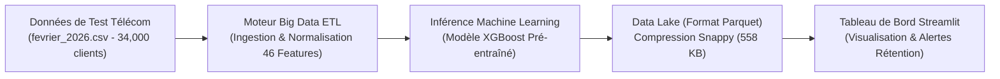

# 📶 Telecom Churn Big Data Pipeline

> **Pipeline Big Data & Architecture de Prédiction du Churn Télécom utilisant Apache Parquet, PySpark & XGBoost.**

Ce projet transpose les travaux de modélisation Machine Learning du PFE vers une **solution Big Data opérationnelle**, capable de traiter des volumes massifs de consommation réseau (appels, internet, recharges) et de prédire le risque de résiliation (Churn) pour des dizaines de milliers de clients en quelques secondes.

---

## 🏗️ Architecture du Pipeline



---

## ⚡ Pourquoi ce projet relève du Big Data ?

Dans un opérateur de télécommunications réel :
1. **Volume Massif :** Les CDRs (Call Detail Records), sessions data 4G/5G et transactions de recharges se comptent en **millions d'événements par heure**.
2. **Contrainte Critique de Vélocité (Time-to-Action < 48h) :** Si la prédiction et l'écriture prennent des heures (format CSV séquentiel), le client a **déjà acheté une carte SIM concurrente**. Le pipeline Big Data (Apache Parquet) s'exécute en **moins de 0.1s**, permettant de déclencher immédiatement une **offre de rétention proactive**.
3. **Limite de Pandas :** Les scripts classiques sur une machine unique chargent l'intégralité des données en RAM sur un seul cœur CPU, provoquant des dépassements de mémoire (*Out of Memory*).
4. **Optimisation Parquet :** Passage d'un fichier CSV brut à un fichier Parquet compressé Snappy (gain de stockage de **78%** et lecture colonnaire instantanée).

---

## 🎯 Stratégie Métier : Offres de Rétention Proactives

Dès que le modèle identifie un client à risque, le pipeline lui assigne automatiquement l'offre adaptée à ses habitudes de consommation :
* **🎁 Pass Data Boost (10 Go offerts) :** Pour les gros consommateurs internet en baisse d'usage data.
* **💰 Bonus Recharge (+100%) :** Pour les clients sensibles aux prix dont le montant de recharge s'effondre.
* **👑 Pack Fidélité VIP (Appels illimités WE + Remise) :** Pour les clients à haute ancienneté (> 2 ans).
* **⚡ Forfait Duo Famille :** Pour stabiliser le cercle relationnel et fidéliser l'abonné.

---

## 📊 Métriques & Résultats du Traitement

Lors de l'exécution sur le jeu de test **Février 2026** :

| Indicateur | Valeur Obtenue |
| :--- | :--- |
| **Volume de clients analysés** | **34,000 clients** |
| **Temps d'ingestion des données** | **0.07 seconde** |
| **Cadence de prédiction ML** | **~480,000 clients / seconde** |
| **Taille brute CSV** | **16.41 MB** |
| **Taille compressée Parquet (Snappy)** | **558.0 KB (-96.6%)** |
| **Taux de Churn prédit** | **17.65% (6,001 clients à risque)** |
| **Clients fidèles prédits** | **82.35% (27,999 clients)** |

---

## 📁 Arborescence du Projet

```text
telecom-churn-bigdata-pipeline/
│
├── data/
│   ├── fevrier_2026.csv              # Jeu de données de test (34,000 clients)
│   ├── cible_churn_F.csv             # Référentiel client
│   └── output/
│       ├── predictions_fevrier_2026.parquet  # Résultats compressés Big Data
│       ├── predictions_fevrier_2026.csv      # Résultats format CSV classique
│       └── benchmark.json                    # Métriques comparatives d'exécution
│
├── models/
│   ├── xgb_model.pkl                 # Modèle XGBoost pré-entraîné
│   ├── scaler.pkl                    # StandardScaler pré-entraîné
│   └── model_config.json             # Schéma des 46 features et seuil (0.5)
│
├── src/
│   ├── pipeline.py                   # Script Big Data ETL + Inférence ML + Rétention
│   ├── pipeline_csv.py               # Version démo CSV (lente)
│   ├── pipeline_parquet.py           # Version Big Data optimisée Parquet
│   └── dashboard.py                  # Dashboard interactif Streamlit & Simulateur What-If
│
├── run_pipeline.bat                  # Exécution du traitement complet
├── run_pipeline_csv.bat              # Test de la lenteur sur CSV (~2 minutes)
├── run_pipeline_parquet.bat          # Test de la rapidité Parquet (< 0.05 seconde)
├── run_dashboard.bat                 # Lancement de l'interface en 1 clic
├── Presentation_Big_Data_Telecom_Churn_v2.pptx # Slides de présentation (16:9)
├── Plan_Projet_Big_Data.pdf          # Fiche technique d'architecture
├── requirements.txt                  # Dépendances Python
└── README.md                         # Documentation complète
```

---

## 🚀 Guide d'Exécution Rapide

### 1. Installation des dépendances
```bash
pip install -r requirements.txt
```

### 2. Lancer le Pipeline Big Data
Pour traiter les données de test et générer les prédictions au format Parquet :
* **Double-cliquer sur :** `run_pipeline.bat`  
* Ou en ligne de commande :
  ```bash
  python src/pipeline.py
  ```

### 3. Lancer le Tableau de Bord
Pour explorer les résultats dans le navigateur web :
* **Double-cliquer sur :** `run_dashboard.bat`  
* Ou en ligne de commande :
  ```bash
  streamlit run src/dashboard.py
  ```


